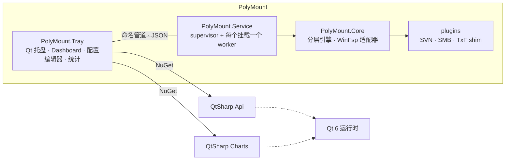
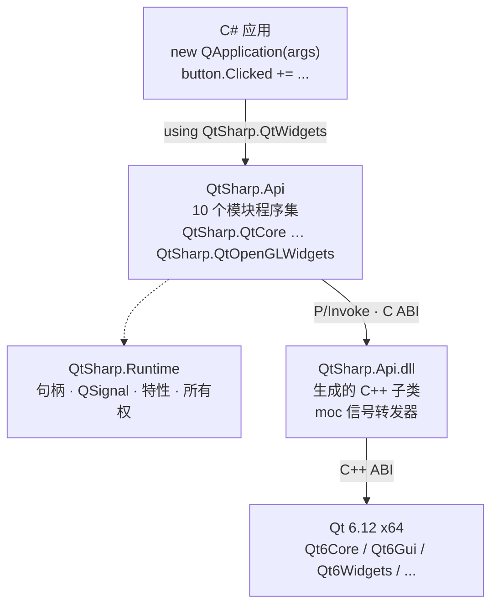
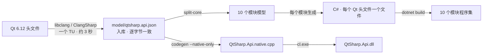
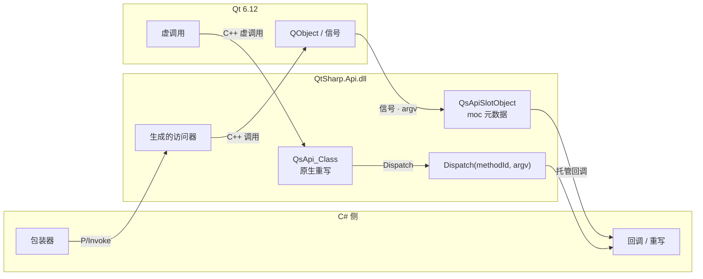
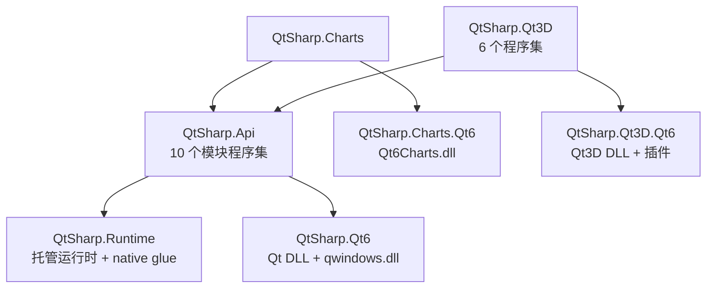

# 像 PyQt 一样在 C# 里写 Qt

> QtSharp：从 Qt 头文件生成绑定。PolyMount 的托盘、配置界面和统计图表已经在用。

如果你写过 PyQt，下面两段代码应该很眼熟。

PyQt6：

```python
from PyQt6.QtWidgets import QApplication, QWidget, QVBoxLayout, QLabel, QPushButton

app = QApplication([])
window = QWidget()
layout = QVBoxLayout(window)
label = QLabel("Hello, PyQt")
button = QPushButton("Count")
clicks = 0

def on_clicked():
    global clicks
    clicks += 1
    label.setText(f"clicked {clicks} time(s)")

button.clicked.connect(on_clicked)
layout.addWidget(label)
layout.addWidget(button)
window.setWindowTitle("Hello")
window.show()
app.exec()
```

QtSharp：

```csharp
using QtSharp.QtWidgets;

var app = new QApplication(args);
var window = new QWidget();
var layout = new QVBoxLayout(window);
var label = new QLabel("Hello, QtSharp");
var button = new QPushButton("Count");
int clicks = 0;

button.Clicked += _ => label.SetText($"clicked {++clicks} time(s)");
layout.AddWidget(label);
layout.AddWidget(button);
window.WindowTitle = "Hello";
window.Show();
return app.Exec();
```

`QApplication`、`QWidget`、`QPushButton` 都是真的 Qt 类。C# 里 `new` 出来的每个对象背后是一个活着的 `QObject`；`button.Clicked += ...` 连的是 moc 元数据里的那个信号，`app.Exec()` 进的是 Qt 自己的事件循环。对象销毁、父子关系、虚函数回调，走的也都是 Qt 的规则。

差别主要在语言习惯。PyQt 的 `clicked.connect(fn)` 在 C# 里是 `Clicked += fn`，`setText()` 保留原名，`setWindowTitle()` 变成 `WindowTitle` 属性。更完整的对应关系大概是这样：

| PyQt | QtSharp |
|---|---|
| `button.clicked.connect(fn)` | `button.Clicked += fn` |
| `button.clicked.disconnect(fn)` | `button.Clicked -= fn` |
| `button.clicked.emit(True)` | `button.ClickedSignal.Emit(true)` |
| `label.setText("...")` | `label.SetText("...")` |
| `window.setWindowTitle("...")` | `window.WindowTitle = "..."` |
| `pyqtSignal(int)` | `[QtSignal] public event Action<int> ValueChanged;` |
| `pyqtProperty(int)` | `[QtProperty] public int Value { get; set; }` |
| `sip.isValid(obj)` | `obj.IsAlive` |
| `QVariant.value()` | `QVariant.ToObject()` |
| `QDateTime.toPyDateTime()` | `qdt.ToDateTime()` |

QtSharp 的目标就是“PyQt 的 C# 版”：Qt 的类名、Qt 的信号、Qt 的所有权规则，换一层语言外壳。它不是要发明一套新的 UI 框架。会 PyQt 的人不需要重新学一套 Qt 概念，只是把 Python 的写法换成 C#；Qt 的文档、示例和社区答案也仍然适用。PyQt 是 Riverbank 的 Python 绑定；这里只是拿它的用法当参照。

子类也是同一种写法：PyQt 里 `class Clock(QWidget)` 加 `paintEvent`，在 QtSharp 里是 `class Clock : QWidget` 加 `override PaintEvent`；`pyqtSignal`/`pyqtProperty` 换成 `[QtSignal]`/`[QtProperty]`。后面的虚函数一节有一个完整的 `Clock` 子类。

0.3.0 的模型覆盖 496 个类、10,506 个方法、885 个虚函数、511 个枚举、816 个 `Q_PROPERTY`、463 个信号和 70 个命名空间函数，分在十个基础程序集里；QtCharts 和 Qt3D 是另外两族可选的扩展包。项目在 [github.com/ProxyCheng/QtSharp](https://github.com/ProxyCheng/QtSharp)，MIT。只支持 Windows x64、Qt 6.12.x 和 .NET 10，0.3.0 还是 pre-1.0。

## 原来的 QtSharp 为什么不行

QtSharp 这个名字不是新造的。2015 年，[Dimitar Dobrev 做过一个同名项目](https://github.com/ddobrev/QtSharp)：用 CppSharp 给 Qt 生成 Mono/.NET 绑定。[NuGet 上的 `QtSharp`](https://www.nuget.org/packages/QtSharp) 就是它，只发到 0.0.2（2015 年），目标框架 .NET Framework 4.5。

| 对比项 | 原版 QtSharp（2015–2019） | 这个项目 |
|---|---|---|
| 前端 | CppSharp | ClangSharp / libclang |
| Qt | Qt 5，只在 Windows/MinGW 上测过，可执行文件必须是 32 位 | Qt 6.12，MSVC，Windows x64 |
| .NET | .NET Framework 4.5 / Mono | .NET 10 |
| 产物 | 绑定生成器 + alpha 二进制，Qt 要自己装 | 八个 NuGet 包，Qt 运行时和 native glue 随包走 |
| 状态 | GitHub 仓库标记 obsolete，[GitLab](https://gitlab.com/ddobrev/QtSharp) 上的活动停在 2019 年前后 | 0.3.0，仍在开发 |

旧项目不是做得不好。它解决的是 Qt 5 + Mono 时代的问题，也证明了“用 CppSharp 生成 Qt 绑定”这条路能走通。但它停在了那个时代：实际停在 Qt 5，.NET 只有 Framework，可执行文件是 32 位，Qt 不自带，QML 交互一直没加。项目在 2019 年前后停更：GitHub 仓库标记 obsolete，代码搬到 GitLab 后没有继续；公开讨论里提到的主要障碍，是从 .NET Framework/Mono 迁到 .NET Core 的成本。

PolyMount 需要 Qt 6、.NET 10 和 64 位；这三条旧 QtSharp 都不满足。这不是换个配置就能补上的差距，是前端、运行时和打包方式都要重做。所以这个项目没有在旧 QtSharp 上改，而是从 Qt 6.12 的头文件重新生成。包名用 `QtSharp.Api`，不是 `QtSharp`，就是为了不和 2015 年的那个包撞名。这个项目最早也用了 CppSharp，后来发现投影层是主要的不稳定源——旧 QtSharp 也建立在同一层上。

## 已经在用：PolyMount

[PolyMount](https://github.com/ProxyCheng/PolyMount) 是一个把远程仓库挂成 Windows 盘符的工具：文件按需拉取，读过的进缓存，写操作落在 overlay 里，底下可以是 SVN 仓库或另一台机器上的 SMB 共享。它的服务端是 .NET、WinFsp 和几个插件；桌面端的界面是 `PolyMount.Tray`，一个 Qt 应用。

托盘图标、Dashboard、配置编辑器、凭据管理器、录制面板，以及统计窗口里的六张趋势图，都是用 C# 写的 Qt 代码。统计图用的是 `QtSharp.Charts` 的 `QChartView`。



这是 PolyMount 托盘入口里的一段真实代码：

```csharp
_tray = new QSystemTrayIcon();
_tray.SetIcon(TrayIcons.App);
_tray.SetToolTip("PolyMount");
_menu = BuildMenu();            // keep a reference so it is not garbage-collected
_tray.SetContextMenu(_menu);
_tray.Activated += reason =>
{
    if (reason is QSystemTrayIcon.ActivationReason.Trigger
        or QSystemTrayIcon.ActivationReason.DoubleClick)
        ShowDashboard();
};
_tray.SetVisible(true);
```

`QSystemTrayIcon`、`Activated` 事件、枚举的 C# 模式匹配，和 PyQt 的 `tray.activated.connect(...)` 是同一个东西。`PolyMount.Tray` 的工程文件里只有两个 QtSharp 的 `PackageReference`：`QtSharp.Api` 和 `QtSharp.Charts`。Qt 的 DLL、平台插件、native glue 由包的依赖和 `buildTransitive` 拷到输出目录。QtSharp 这部分不需要装 Qt SDK，也不需要 C++ 工具链；PolyMount 自己的 Explorer 扩展和 TxF shim 仍然要 MSVC，但那是另一件事。

还有一个和打包有关的细节：PolyMount 是 GPLv3，原因之一就是它用 Qt Charts 画图，而 Qt Charts 是 GPLv3-or-commercial，不是 LGPL。这正是 QtSharp 把 Charts 拆成单独包的原因——不用图表的程序不会被迫继承 GPLv3。

## 它是怎么搭起来的



C# 这边看到的是 PyQt 形状的 API。`QtSharp.Api` 里的十个程序集只负责声明和 marshalling；真正跨过 ABI 的是下面两层：生成的 C++ glue 和 Qt 自己的 DLL。`QtSharp.Runtime` 是手写的薄运行时，管句柄、信号、所有权，不引用任何 Qt 类型。Qt 的 DLL 和 `platforms\qwindows.dll` 来自 `QtSharp.Qt6`，由 NuGet 依赖带进来。

## 生成链路



模型是 clang 读出来的事实：每个类的方法、虚函数、信号、`Q_PROPERTY`、枚举，以及命名空间函数。它做了归一化：保留 C++ 原名，只留最长可 marshal 的前缀，把 `qreal` 退化成 `double`，把 `QList<T>`、`QMap<K,V>` 这样的容器整理成统一的类型词汇。模型是 JSON，排序固定，同一个输入永远得到同一串字节。

生成器是模型到代码的纯函数，输入只有模型和仓库里的运行时源码。同一个模型跑两次，输出树必须逐字节一致。它没有模板引擎，就是一段 C# 程序读 JSON、拼字符串、写文件。模板引擎看起来省事，但条件一多，模板本身就会变成一门没人测试的语言。

运行时是手写的，很小：句柄、信号包装、特性、所有权、marshal 辅助。生成树里没有手写代码；手写的运行时在 `runtime/` 和 `native/`，生成器在 `gen/`。重新生成不会覆盖任何人的修改，因为根本没有修改可覆盖。

模型入库不太常见。通常的做法是每次构建都从头解析头文件，生成代码，编过去就算数。那样的问题在于，一旦输出变了，你很难判断是 Qt 头文件变了、解析器变了，还是生成器变了。QtSharp 把模型当成一个可以 diff 的产物：`tools/regen-api.ps1` 先重新提取，和入库的 `model/qtsharp.api.json` 逐字节比较；再跑两次代码生成，比较两棵输出树；然后才编译、跑测试。任何一步不一致，门禁就停在那里。

门禁抓过的东西都很具体。0.3.0 重新从 Qt 6.12 提取时，`QScatterSeries::colorChanged` 和 `markerSizeChanged` 不见了：6.12 把这两个声明包进了 `QT6_ONLY`，而信号和 `Q_PROPERTY` 的扫描器读的是原始头文件文本，不认识这层包装。另一次是 `.gitattributes` 没把 `model/*.json` 钉成 LF，Windows 上 `core.autocrlf=true` 把模型检出成 CRLF，门禁在每次全新 checkout 上都报“模型变了”。

这两个 bug 都不会让编译失败。它们只会让绑定悄悄少几个成员，或者让门禁变成狼来了。生成式绑定最怕这种安静的漂移。

## 把前端换掉

最早的前端是 CppSharp。

那时的链路里，CppSharp 只负责两件事：驱动 clang 解析 Qt 头文件，把 clang AST 投影成托管的 C++ 对象。passes、type maps、codegen、glue 都不用了。问题全出在第二层：

- 37 个类连续跑 5 次，得到 5 个不同的模型哈希；
- 参数类型会张冠李戴，跨翻译单元的类型身份要拿 USR 比才相等；
- `Type.Desugar()` 的顺序会影响结果，`CompleteDeclaration` 经常是 null；
- 为了自校验，只能分块解析，每块解析两次，一次全量提取 165 秒。

clang 本身没问题，模型、生成器、运行时也没问题。出问题的是中间那层投影。

换的时候没有重写产品。model JSON 早就把上下游隔开了：上面是“从 AST 读事实”，下面是“模型 → 代码”。我只换了上面那一层，下游一行没动。验收方式也很直接：拿新前端去复刻旧模型。44 个类、1472 条事实，1451 条逐字一致，剩下 21 条是模型本来就有的“最长可 marshal 前缀”规则（比如 `QPixmap::load(QString, const char*, Flags)` 只保留 `load(QString)`），没有一条丢失。换完之后，一次解析、一个翻译单元、大约 3 秒，连续跑三次输出逐字节一致。

这次替换给我的经验是：接口定死之后，换前端是一次可验证的替换，不是重写。

新前端也不是所有东西都从 AST 读。信号是个例外：moc 不在提取阶段运行，`Q_SIGNALS` 在普通编译里展开成的东西 clang 看不见。所以信号是扫头文件文本找出来的，参数类型再回 AST 里读。这听起来不优雅，但它把“哪个成员是信号”和“信号参数是什么类型”分开处理，反而比让 clang 猜更可靠。

## 运行期：两个方向



C# 调 Qt 是最直接的一段：生成的 wrapper 把参数 marshalling 好，P/Invoke 到 `QtSharp.Api.dll`，再调 Qt 的方法。反过来，Qt 调 C# 有两条路，分别对应信号和虚函数。这也是整个绑定最难的两块。

### 信号：不要在生成期解决运行期的问题

信号的第一个版本是逐信号生成 glue：每个信号写一段 C++，用 `static_cast<void (Class::*)(...)>(&Class::signal)` 定位成员指针，再 `connect` 到一个静态转发函数。

这个做法遇到重载信号时立刻失效：`static_cast` 需要精确的函数类型，而头文件里同一个信号名可能有两三个重载。`QPrivateSignal` 是 private 的，没法在类外命名。头文件里没写参数名的信号，也解析不出来。

后来换成了 moc 元数据加一个转发器。连接时把签名规范化，`metaObject()->indexOfSignal()` 找到索引，`QMetaMethod::parameterMetaType(i).id()` 记下每个参数的类型；调用时 Qt 把参数放进 `void** argv`，`argv[0]` 是返回槽，剩下的是实参。托管侧只认这一个入口。

`QPrivateSignal` 是个有意思的例子。我们花了很久想办法在 C++ 侧命名它，结果发现 moc 在运行期元数据里已经把它剥掉了：`timeout(QPrivateSignal)` 在元数据里就是 `timeout()`。这个问题在那一层根本不存在。

重载也一样。元数据里两个 `activated` 是两条不同的签名，`indexOfSignal` 会给出不同的索引，不需要在生成期做任何消歧。C# 这边如果遇到同名重载，第二个开始加数字后缀（`Activated2Signal`/`Activated2`），只是为了 C# 编译得过去。

从 C# 发信号也要走同一条路。这里有个很容易写错的细节：`indexOfSignal()` 返回的是方法表里的绝对索引，而 `QMetaObject::activate()` 要的是这个信号在当前元对象自己的信号表里的位置。两者中间隔着 slots，直接用 `index - methodOffset()` 会激活错的信号，或者什么都不激活。要用 `QMetaObjectPrivate::signalIndex()` 和 `signalOffset()` 换算。

生成出来的 C# API 有两种写法：

```csharp
button.Clicked += handler;            // C# 事件
button.ClickedSignal.Connect(handler);
button.ClickedSignal.Emit(false);     // 只有 QSignal 有 Emit
```

`+=` 和 `-=` 是真连接的：`-=` 会拿存下来的 `QMetaObject::Connection` 调 `QObject::disconnect`，不只是从 C# 事件列表里删一个委托。事件和 `QSignal` 都保留，也是这个原因：事件适合日常订阅，`QSignal` 适合手动 emit 和批量连接。

还有一个容易误会的地方：`Q_PROPERTY` 的 `NOTIFY` 不会自动变成 C# 事件。想要 `valueChanged`，就得自己 `x.Changed += ...`，或者用 `XxxSignal.Connect`。

### 虚函数：让 cl.exe 处理 ABI

虚函数的第一版是运行期 thunk：用 `Marshal.GetFunctionPointerForDelegate` 造一个函数指针，塞进 vtable。这个方案在 x64 上要处理隐藏的 sret 参数、`this` 的位置、返回值写回 RAX，每一个都能单独踩一遍；委托还得保活，不然 GC 一回收，Qt 那边就跳到野地址。

后来改成生成 C++ 子类。每个绑定类生成一个 `QsApi_<Class> : public <Class>`，override 所有需要暴露的虚函数。override 里把参数装进 `void* argv[]`，调用唯一一个托管入口：

```csharp
[UnmanagedCallersOnly(CallConvs = new[] { typeof(CallConvCdecl) })]
internal static void Dispatch(IntPtr userData, int methodId, IntPtr argv)
{
    ...
}
```

`userData` 是托管对象的 `GCHandle`，`methodId` 是虚函数在继承链里的位置，`argv[0]` 是返回槽。ABI 的事全部交给 `cl.exe`：sret、`this`、RAX 都不需要托管侧知道。函数指针指向静态代码，不需要保活，GC 也不会把它移走。

代价是每个 Qt 版本、每个平台都要重新编译一份原生包装。发布包里有一个 `QtSharp.Api.dll`，原因也在这里；项目目前只支持 Windows x64，也是这个原因。

这里面有两个坑值得记下来。

第一个是 private 虚函数。Qt 在 `QAbstractListModel` 里用 private 虚函数做 NVI（`columnCount`、`hasChildren`、`parent` 之类）。生成器一开始把它们也当成可 override 的点，生成了一个返回 `default` 的 C# 实现。结果 `QStringListModel` 的每个索引都失效了。修法是：这些槽仍然留在继承链里（否则方法编号会错位），但不生成 C# virtual、不生成 native override、不生成 dispatch case。

第二个是“这个对象是谁造的”。我们自己 `new` 出来的对象，装了 native dispatch 钩子，虚函数应该进托管 override；从 `FromHandle`/`FromOwnedHandle` 采纳来的对象，包装的是 Qt 已经造好的对象，虚函数应该直接走 C++ 的虚调用。这两条路靠一个 `__managedSubclass` 标志区分。采纳来的对象走的是 `QsApiAccess_<Class>::Call_...`：它不做 dispatch，只把这次调用转成一次真正的虚调用。有一次某条构造路径忘了置位，托管子类和 native override 互相回派，栈直接溢出。这个 bug 只在 `test-custommodel` 里出现，因为只有它真的让 Qt 去驱动 `QAbstractItemModel` 的回调。

虚函数的开放范围也不是全量的。生成器只在一个名字闭包里发布虚函数：某些类自己声明的虚函数名，加上它们的继承子树。想开一个新的扩展点，就把类加进那张表。不能做全局名字闭包，因为 `QPicture::setData(const char*, uint)` 这种同名但无关的方法会一起被打开，编译直接失败。

一个 C# 子类大概长这样：

```csharp
sealed class Clock : QWidget
{
    public Clock(QWidget parent = null) : base(parent) { }

    public override QSize SizeHint() => new QSize(200, 200);

    public override void PaintEvent(QPaintEvent e)
    {
        using var painter = new QPainter(AsQPaintDevice());
        using var background = new QColor("#202020");
        painter.FillRect(new QRect(0, 0, Width, Height), background);
    }
}
```

`AsQPaintDevice()` 是因为 `QWidget` 在 C++ 里有第二个基类 `QPaintDevice`，C# 只有一个类继承链，所以第二个基类通过 `As<Base>()` 显式取。`Width` 是 `Q_PROPERTY` 生成的属性，`width()` 是原来的访问器，两个都存在。

## 所有权：地址不是身份

所有权是整套绑定里最容易出人命的部分。GC 是非确定的，Qt 的父子关系是确定的；两边同时觉得自己拥有一个对象，就会 double free，或者更糟：Qt 还在用，托管侧已经把它删了。

现在的规则是这样：

- `new` 出来的对象归你，`Dispose()` 或终结器删它；如果你把它交给了 Qt（设了 parent、放进 layout/scene/view），生成的析构会先问 `parent()`，有 parent 就不删。
- Qt 拥有的对象，GC 永远不删。
- Qt 销毁一个对象之后，再碰它的 wrapper 抛 `ObjectDisposedException`，而不是访问违例。
- 已经销毁的 wrapper 和 null 比较相等，`w.IsAlive` 问的是同一个问题。只有 `==` 是感知存活状态的；`w?.Use()`、`w ?? fallback`、`w is null` 判断的是引用本身。这个行为和 Unity 的 `UnityEngine.Object` 一样，第一次用会觉得别扭，但它让 `if (w != null) w.Use();` 成为一个正确的守卫。

实现上，Qt 那边只装一个进程级的 `destroyed` 钩子。槽的 `userData` 就是对象地址，Qt 销毁对象时会连槽一起释放，所以不需要每个对象一个 `GCHandle`，也不需要委托保活。

这里踩过一个很典型的坑，值得展开说。

最早的失效表是按地址记的：`HashSet<IntPtr>` 记录哪些地址已经死了，`Dictionary<IntPtr, List<IntPtr>>` 记录谁拥有谁。问题是分配器会把刚释放的地址交给下一个对象。于是一个迟到的 `destroyed` 通知（`deleteLater`、父对象析构、item 滚出视图）会把这个地址上现在的对象也标死；反过来，`Watch` 看到地址已经死过，就拒绝再监听新对象，新对象从此永远不会失效。还有一个连带问题：owner 析构时，会把记录里的 item 地址当时的主人一起失效掉。

这个问题在一个 layer picker 里表现为偶发的 `ObjectDisposedException`：`new LayerPicker → QListWidget.AddItem(item) → 图标/像素图/控件频繁分配 → SetItemWidget(item, card)`，中间只要有一次地址复用，后面的对象就可能被前一个对象的销毁通知误伤。

修法是给每个地址加一个 generation。销毁通知带上是为哪一代发的；地址上注册新对象时 generation 加一；通知的 generation 对不上就丢掉。`ownedItems` 也从裸地址改成 `(address, generation)`，只失效还活着的那一代。

PyQt 和 PySide 都没有这个问题。PyQt 的 sip 把 invalid 标志放在 Python 对象上，`monitored` 只存活着的实例，`on_destroyed` 先 `erase` 再按当时的指针找 wrapper；PySide 的 `BindingManager` 有 `unregisterWrapper`/`releaseWrapper`，有效性是 per object 的，父子关系记在 Python 对象之间，不是 owner 地址到 child 地址。它们也不会把“死过的地址”持久化下来。我们多做的持久化，把一个理论上的窗口变成了真实会命中的窗口。

异常处理也是同一个边界问题。信号回调和虚函数 override 都跑在 Qt 的 C++ 栈帧里，异常没有地方落。PyQt 的选择是打印 traceback 然后 `qFatal()`，PySide 是打印后继续。QtSharp 在边界上 catch，写到 stderr，并触发 `ApiRuntime.UnhandledCallbackException`。默认不杀进程，但你可以订阅这个事件，让它在测试里失败。

## 值类型：不是所有 Qt 类都该有句柄

`QPointF` 是两个 double，`QRect` 是四个 int。给它们每个都分配一个 native 对象、注册进 wrapper 缓存、挂一个终结器，成本不在单次调用，而在批量路径上：一个包含十万个点的 `QPolygon`，如果每个点都变成一个句柄，就是十万次分配。图表库里的 `series.replace(points)` 会把这件事放大到不可接受。

现在的做法是把“可平凡复制”的值类型做成 C# struct，直接按字节过 ABI。准入条件是：这个类型的拷贝不拥有任何东西。`QPointF`、`QSize`、`QRect`、`QDate`、`QTime`、`QVector2D/3D/4D`、`QQuaternion` 都过了；`QColor`、`QPen`、`QBrush`、`QFont`、`QDateTime`、`QString` 这些是隐式共享的，拷贝里带一个引用计数指针，按位复制会 double free，所以它们继续用句柄。`QMatrix4x4` 也保留句柄，因为从 Qt 6.11 起就没有 `m11()` 到 `m44()` 这组访问器了，POD 拼写需要的那条路走不通。

`QRect` 是个很好的例子。它的内存布局是左上角和右下角两个点（`x1, y1, x2, y2`），但访问器拼的是 `x/y/width/height`，而且 `right()`/`bottom()` 是包含端点的。所以 POD 跟着角走，两个转换函数显式经过 `QPoint`，不能用访问器凑。`QDate` 和 `QTime` 各是一个整数，但访问器不是字段形状（`toJulianDay()`、`msecsSinceStartOfDay()`），转换也得写死。

这些值类型有没有退化，测试是能看出来的。运行时暴露两个计数器：注册了多少个 wrapper，native 侧监听了多少个对象。十万个点交给 `QPolygon`，wrapper 数量应该只加一（polygon 本身），监听数不动（值不是对象）。重复五轮，两个数各加五，托管堆保持平稳。如果哪天某个值类型又变回句柄，这两个数就会往上爬。

和 BCL 的转换是显式的，没有隐式运算符。`QDateTime` 可以用 `new QDateTime(dateTime)` 构造，用 `ToDateTime()` 取回；`QPoint` 到 `System.Drawing.Point` 要显式转。原因很实际：句柄类的 `==` 比较的是 wrapper 身份，如果 `qdt == dateTime` 能编译，它会静默地返回 false。无效或越界的 Qt 值抛 `InvalidOperationException`，不静默回绕。

## C# 子类自己的信号和属性

生成类之外，C# 子类还可以声明自己的信号和属性：

```csharp
[QtSignal] public event Action<int> ValueChanged;
[QtProperty] public int Value { get; set; }
```

Qt 的元对象是 moc 在编译期生成的，运行时没有空位放这些新成员。所以这里用 `QMetaObjectBuilder`（Qt 的私有但随二进制发布的一个头文件）在运行期建一张新的元对象表，只包含这个 C# 类自己加的成员，super class 指向原来的元对象，再用一个 `QAbstractDynamicMetaObject` 把它装到对象上。装好之后，`QObject::metaObject()` 返回的就是这张表，`indexOfSignal`/`indexOfProperty` 能找到新成员，`QMetaObject::activate` 也能像普通信号一样发射。

表的键是类名加上成员签名，同一个 C# 类型的所有实例共享一张表。属性读写走 `QMetaObject::Call` 的 ReadProperty/WriteProperty/ResetProperty，值以裸 C++ 类型传进回调，托管侧自己做转换。`Q_PROPERTY` 的 `Notify`、`Reset`、`Constant`、`Final`、`Required`、`Designable`、`Scriptable`、`Stored`、`User`、`Revision` 都映射到了 `[QtProperty]` 的参数上；`BINDABLE` 没做，因为它需要的不只是一个标志位。

这个机制的前提是：必须在任何连接之前装表，也就是对象一构造完就装。生成类不需要这层机制，它们的属性和信号本来就在 moc 的表里；所以生成成员带的是只读标记 `[QtNativeProperty]`/`[QtNativeSignal]`，反射能分清哪些是生成的、哪些是用户声明的。

## 怎么证明它没坏

绑定最容易骗自己的地方是“编译通过”。生成的 C# 能编译、能 `new` 出一个窗口，不代表 `paintEvent` 会回调、模型视图会取数、打印会出纸。

QtSharp 的主要验收方式是拿 Qt 自己的例子当测试。官方例子的 C++ 源码被逐个改写成 C#，每个例子同时是一个自测：驱动生成的 API，检查看到的结果，打印 `[PASS]`/`[FAIL]`，最后一行是 `[SELFTEST OK]`。门禁读的就是这行。

| 套件 | 窗口 | 断言 |
|---|---:|---:|
| 官方 Qt 例子 | 28 | 899 |
| 绑定专项测试 | 11 | 387 |
| Qt Charts | 38 | 570 |
| Qt3D | 3 | 37 |

一共 80 个窗口、1893 条断言。

这些例子不是一份手写的名字表。类上挂 `[Demo("qtwidgets-analogclock")]`，catalog 在自己的程序集里反射发现；重复或格式不对的注册在启动时直接失败。加一个例子只动例子文件，不动脚本。

窗口是并行跑的，默认 `min(6, 核数)`。每个窗口跑完还会留大约一秒让人看。这里有一个已知的收尾 flake：机器同时在干别的活时，Qt 拆进程的过程中可能以一个 `0xC000041D` 退出，而且是在所有断言都通过、`[SELFTEST OK]` 已经打印之后。门禁的做法是重试一次，第二次还失败就把这个窗口自己的输出打出来，保证失败可归因。它不是断言失败，门禁也没有把它藏起来。

`QT_QPA_PLATFORM=offscreen` 不是一个选项。有几个例子断言的是渲染出来的像素，还有一个没有 `qwindows` 会直接崩。这挺麻烦，但它是真的：你可以在无头环境里跑一部分测试，不能拿它冒充全部。

还有一个测试被故意停牌了。`tests/WindowFlagsApi.cs` 的 115 条断言全过，但大约十次里有三次会在 `qwindows.dll` 的收尾阶段死掉（native 的消息泵碰到已经销毁的窗口）。它没有被接进 dispatcher。一个偶发失败的测试比没有测试更糟，尤其是当它失败的原因和被测代码无关的时候。

CI 里跑的是同一套：`binding` job 从入库模型构建绑定，`Smoke tests` job 拉 Qt、编译例子、用同一个窗口池跑。release 也是从入库模型出发，生成器不需要 clang。

## 打包：照着 PyQt6 的形状来



一个 Qt 模块一个程序集、一个 C# 命名空间，一个 addon 一个包。`QtSharp.Api` 里是十个程序集：QtCore、QtGui、QtWidgets、QtNetwork、QtSvg、QtSvgWidgets、QtPrintSupport、QtXml、QtOpenGL、QtOpenGLWidgets。跨模块的类型在生成的 C# 里是全限定名，比如 QtWidgets 里的 `QColor` 写成 `QtSharp.QtGui.QColor`，所以同时 `using` 几个模块的命名空间不会撞。

`QtSharp.Runtime` 是托管运行时加共享的 native glue，`QtSharp.Qt6` 是 Qt 的运行时 DLL 和 `platforms\qwindows.dll`。这两个是 `QtSharp.Api` 的依赖，用 `buildTransitive` 把载荷拷到使用者的输出目录。使用者只写一个 `PackageReference`。PolyMount 的托盘只引用了两个 QtSharp 包就能跑，这套打包设计在真实项目上成立了。

QtCharts 和 Qt3D 各自是一族单独的包：绑定包加一个 Qt 运行时 companion。QtCharts 单独有一个许可证原因：它是 GPLv3-or-commercial，不是 LGPL。放进 `QtSharp.Api` 会让每个使用者都继承 GPLv3；拆出去之后，不用 Charts 的人不受影响。Qt3D 是 LGPLv3/GPLv2/commercial，拆开主要是打包原因：它是六个库组成的一族，不是 qtbase 的一部分。

`QtSharp.Tools` 是开发工具包，带 `rcc`、`uic`、`lrelease`、`lupdate`，以及 MSBuild 的 `.qrc` 支持。`uic` 生成的是 C++，不是 C#；一个 C# 的 `.ui` 编译器还没做。

包名是 `QtSharp.Api`，不是 `QtSharp`——后者是 2015 年那个旧项目，前面已经说过。

## 现在不能做什么

- Windows x64、Qt 6.12.x、.NET 10。没有 Linux/macOS 构建；生成的 wrapper 是 MSVC C++。
- 绑定的模块：QtCore、QtGui、QtWidgets、QtNetwork、QtSvg/QtSvgWidgets、QtPrintSupport、QtXml、QtOpenGL/QtOpenGLWidgets。没绑：QtMultimedia、QtQml/QtQuick、QtPdf、QtWebEngine。
- QtCharts 和 Qt3D 是可选包，不在 `QtSharp.Api` 里。Qt3D 的专属虚函数还不能 override；信号、属性、枚举、flags 正常绑定。
- 嵌套类（`QFont::Tag`、`QTextOption::Tab`）没绑；`const uchar*` 返回值被丢掉（没有长度），所以 `QResource.data()`、`QImage.bits()` 不在。
- QtOpenGL 没有 demo：`QOpenGLFunctions` 没绑，CI 也没有稳定的 GL 上下文。
- 一个参数默认值是“裸枚举量、且不是参数类型自己的枚举”时，重载会被截断（C# 默认值会是 0，Qt 经常把 0 当无效）。boxed value 的默认值已经没问题了。
- QtSql 正在接（`QSqlDatabase`、`QSqlQuery`、`QSqlQueryModel`、`QSqlTableModel`），接完之后基础程序集会从十个变成十一个；0.3.0 的发布包里还没有它。
- 还是 pre-1.0，二进制和源码兼容性会在版本之间变。它不是所有 Qt 模块、所有桌面部署场景的 drop-in replacement。

## 试试看

如果只是想用，去 GitHub Releases 下载 `.nupkg`，把它所在目录加成本地源：

```powershell
dotnet add package QtSharp.Api --source .\downloads
```

然后写一个 `QApplication`，就像文章开头那样。Qt 的 DLL、平台插件、native glue 都会在 build/publish 时拷到输出目录，不需要装 Qt SDK，也不需要 Visual Studio 的 C++ workload。

如果想从源码构建，`tools\regen-api.ps1` 是唯一入口。第一次跑需要：Visual Studio 的 C++ workload（`cl.exe` 和 `vcvarsall.bat`）、Qt 6.12.0 的 MSVC 2022 64 位开发文件、clang 的 builtin headers。Qt 可以用仓库自带的 `tools\build-qt-kit.ps1` 拉：它从 Qt 的在线仓库下载 qtbase、qtsvg 和 addons，合并成一个 kit，再把运行时 DLL 摆好。这条路比 `aqt` 稳，因为 Qt 的仓库已经不再提供 `aqt` 读的那个顶层 `desktop/Updates.xml` 了。

第一次构建会久一点，因为 native glue 是一个很大的翻译单元，最后还要编 80 个窗口并跑完。之后 `dotnet build` 就正常了。

贡献里最有用的东西是一致性 demo。把一个官方例子移植过来，它同时证明了一批 API 是活的、所有权是对的、信号是通的。比单独报一个“某某方法不工作”更容易定位，也更不容易在下次重新生成时烂掉。

QtSharp 离 1.0 还有距离：模块没绑全，uic 的 C# 编译器没做，Linux/macOS 没有，Qt3D 的虚函数扩展点还缺。但它已经能跑完 Qt 自己的 80 个例子，PolyMount 也已经在用它做真实的桌面端。这比“API 看起来像 Qt”更有说服力。

项目在 [github.com/ProxyCheng/QtSharp](https://github.com/ProxyCheng/QtSharp)。如果它在你的某个场景里差一点就能用，欢迎开 issue 说清楚差的是哪一点。
